# n8n Ops Automation

Six AI-assisted n8n workflows that take the repetitive admin off a small business, with guard rules that keep
people in charge, and a measured estimate of the hours they save.

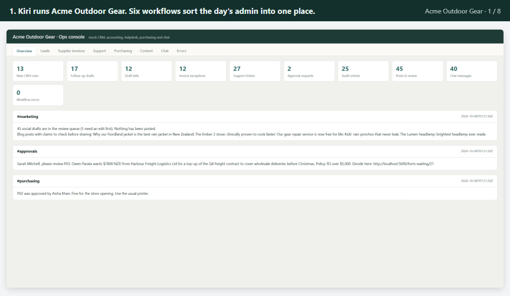

*The day's admin at Acme Outdoor Gear, step by step: sales enquiries, supplier invoices, customer emails, the
morning sales update, purchase approvals and social posts, all prepared for a person to check.*

## What it does

Small businesses lose hours every week to the same chores: typing invoices into the accounts, sorting customer
emails, chasing approvals, writing the same sales update every morning. This project hands those chores to a set
of automated workflows that use AI to read and draft, while fixed rules check the AI's work. Nothing is sent,
paid or posted without a person saying yes.

## A real-life example

Kiri runs **Acme Outdoor Gear**, an invented New Zealand shop that sells packs, tents and rain jackets online, in
four stores and to other shops.

**Before.** Each month her small team handles about 120 sales enquiries, 220 supplier invoices, 600 customer
emails, 80 purchase requests, a daily sales update and a couple of blog posts to share on social media. Done by
hand, at the minutes per task in `data/time_model.csv`, that is about **138 hours a month**. Invoices get keyed in
with the wrong tax, urgent emails sit behind routine ones, and approvals get lost in inboxes.

**With the workflows,** step by step:

1. A shop fills in the website form asking to stock Acme's packs. The workflow checks whether they are already a
   customer, judges how promising the enquiry is, adds them to the customer list and writes a first reply for a
   salesperson to approve.
2. A supplier emails a PDF invoice. The workflow reads it, checks the tax, the totals, the purchase order and
   whether it was already billed, then prepares a draft bill, or holds it back with the reason.
3. A customer writes that a camping stove leaked gas and caught fire. The workflow marks it urgent and alerts a
   person straight away, with a careful draft reply ready.
4. At 7am the team chat gets a five-line sales update. Every number in it has been checked against the sales
   records.
5. A staff member asks to spend $2,400 on posters. The right manager gets a link to a short form and approves it
   there; every step is written to an audit log.
6. A new blog post becomes LinkedIn, Instagram and X posts, waiting in a review queue. Bold claims such as
   "100% waterproof" are flagged before anyone shares them.

**After.** In a test on 132 invented but realistic items, the workflows got 127 fully right (96%). All 24 test
invoices were read correctly with no bad bill created, all 5 urgent safety and legal emails reached a person,
and every restricted purchase (vouchers, wine, whisky, personal items) went to finance. With those measured
results, the estimated workload drops from about 138 to about 56 hours a month: **about 82 hours saved each
month**. The hours are an estimate built on stated assumptions; the accuracy figures are measured.

## How you would use it

1. Install the project and n8n (see [Setup](#setup)), or start everything with Docker.
2. Run `python -m opsflow demo` and open `http://localhost:5678` in your browser. Create your login the first
   time.
3. Open a workflow, for example **Customer support triage**, and press **Execute workflow** to try it on the
   sample emails. Green ticks show each step that ran.
4. Open the ops console at `http://127.0.0.1:8790` to see what the workflows prepared: customer records, draft
   bills, tickets, approval requests and social drafts.
5. To use it for real, point the webhooks at your own website form, email and CMS, swap the mock systems for
   your CRM, accounting and chat tools (see [docs/workflows.md](docs/workflows.md)), and add your AI key.

---

## Features

- **Six production-style workflows**, each with a production trigger (a *webhook*, a web address other systems
  call, or a schedule), a **Try with sample data** trigger for testing, an AI step, guard rules and the shared
  error workflow.
- **The model suggests, the rules decide.** Every AI answer is checked against a fixed schema and business
  rules: tax and totals on invoices, safety and legal wording in emails, the spending policy for purchases,
  invented numbers in summaries and posts.
- **People stay in the loop.** Workflows only write drafts, queues, logs and chat messages. Purchase approvals
  wait on an n8n form for the right approver.
- **Works without a model.** With no API key, or `AI_MODE=off`, every workflow falls back to a rule-based path;
  that path is also the baseline in the evaluation.
- **Runs offline.** A mock-services server stands in for the CRM, accounting system, helpdesk, chat, purchasing
  system and sales database, and serves the labelled test data.
- **Measured.** A runner executes every workflow in a real n8n on labelled items, with a held-out split, and
  reports accuracy, guard hits, latency, model calls, cost and estimated hours saved.
- **Workflows as code.** The n8n JSON is generated from readable Python and JavaScript, unit tested, and checked
  in CI for wiring, secrets and guard rules.

## The six workflows

| Workflow | Trigger | AI does | Guard rules | Ends in |
|---|---|---|---|---|
| Lead intake and enrichment | web form webhook | category, priority, summary, reply draft | duplicate check, spam rules, injection flag, no prices or promises in drafts | CRM row or note, draft awaiting approval |
| Supplier invoice to draft bill | email webhook with PDF | extracts fields to a JSON schema | GST 15%, totals, lines, PO within 5%, known supplier, no duplicates, amounts must be in the PDF | draft bill or exception queue |
| Customer support triage | email webhook | category, priority, reply draft | safety and legal wording always go to a person, no promises in drafts | helpdesk ticket, urgent alert |
| Daily KPI digest | every day at 7am | five-line summary | KPIs computed by SQL and code, every number in the text checked | chat message |
| Purchase approval routing | request webhook | category, restricted flag, approver summary | the spending policy, split-purchase and self-approval rules | auto-approval, return, or approver form, plus audit log |
| Blog post to social drafts | CMS webhook | LinkedIn, Instagram and X drafts | length, links, hashtags, invented numbers, risky claims | review queue |

Details of each, and which real n8n node replaces each mock system: [docs/workflows.md](docs/workflows.md).

## Screenshots

All screenshots come from a real run of the demo.

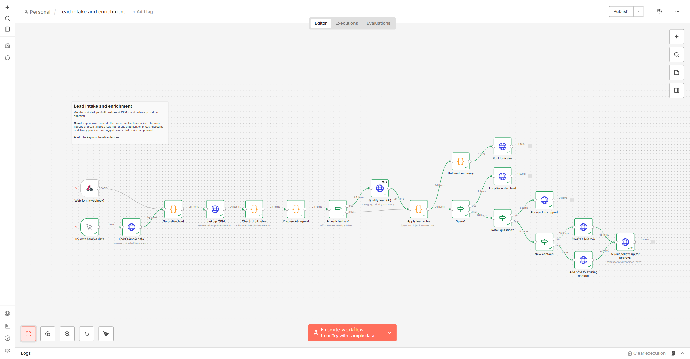
*The lead intake workflow after a run with the 24 sample leads: green ticks on every step, and the number of
leads that took each path (for example 4 spam, 3 retail questions, 13 new contacts, 4 existing contacts).*

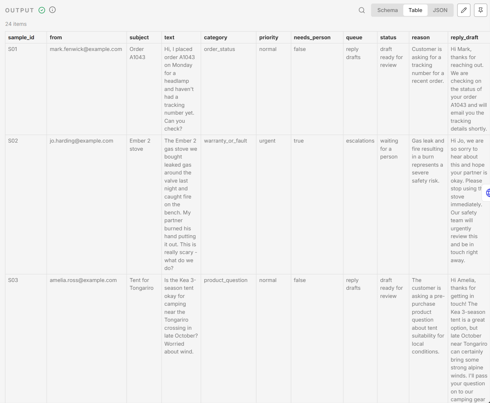
*The decisions for the sample customer emails: topic, urgency, whether a person is needed, the queue, and the
draft reply. The gas-stove email is urgent and waiting for a person.*

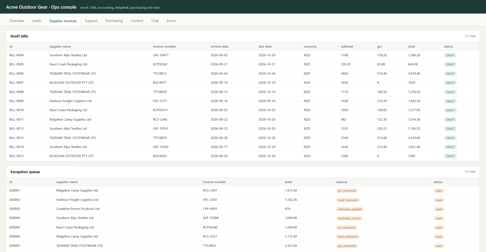
*Supplier invoices in the ops console: twelve draft bills, and twelve invoices held back with the reason (wrong
GST, totals that don't add up, an unknown supplier, a duplicate, a purchase order mismatch).*

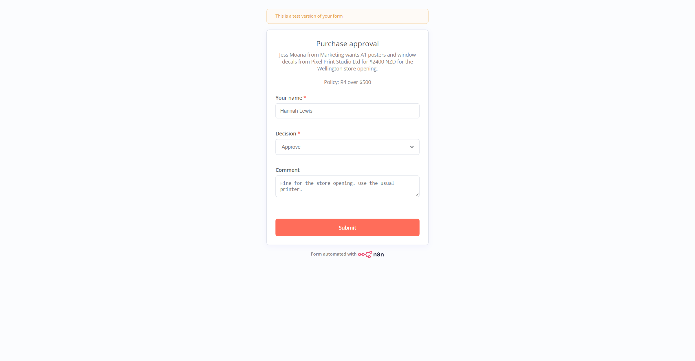
*What a manager sees for a $2,400 poster order: a summary, the policy rule that sent it to them, and a decision.*

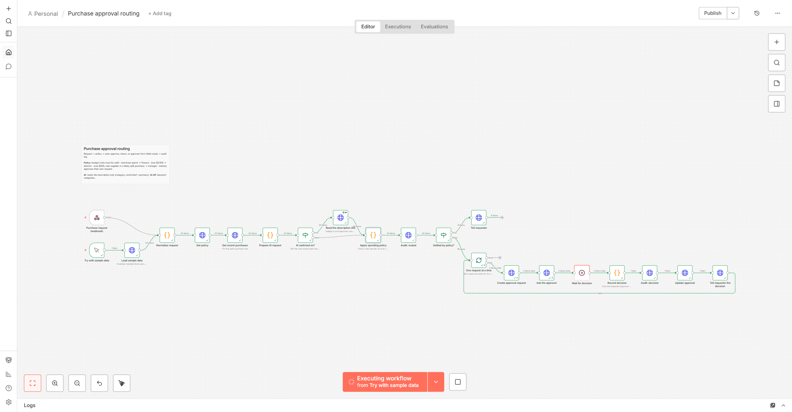
*After that approval, the workflow records the decision, writes the audit log, tells the requester, and pauses
at the next request's form.*

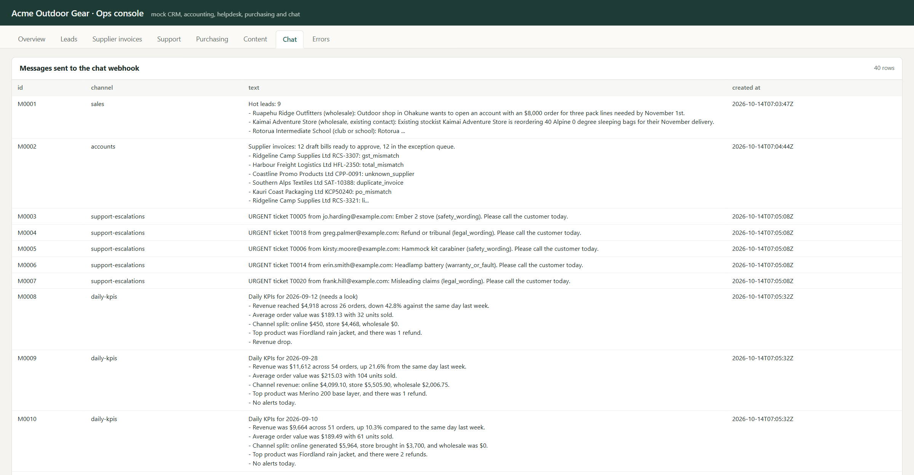
*Chat messages the workflows posted: hot leads, the invoice summary, urgent support alerts and the daily sales
updates.*

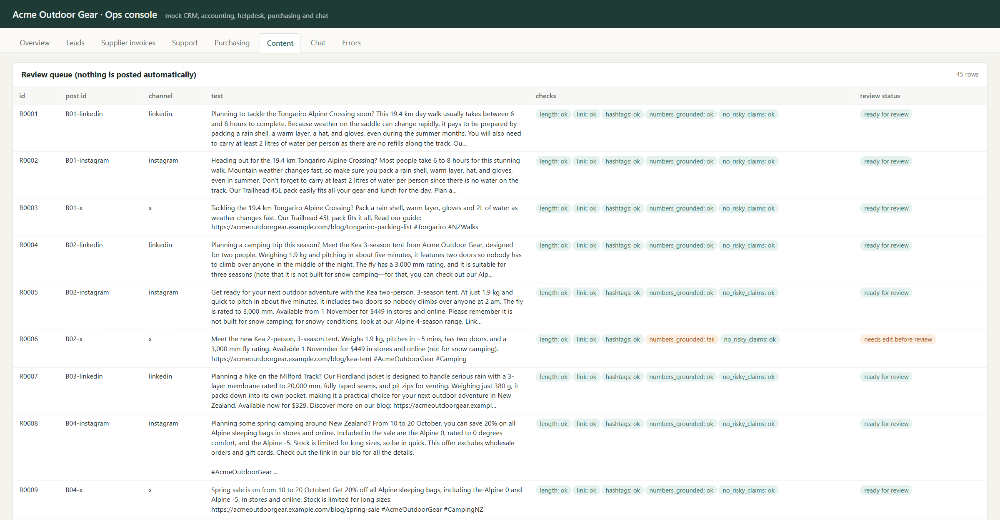
*Social drafts waiting for review, each with its checks: length, link, hashtags, numbers found in the blog post,
and no risky claims.*

More: the other canvases and output tables are in [docs/screenshots](docs/screenshots).

## Architecture

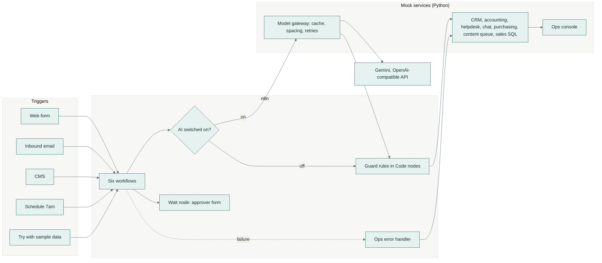

The **model gateway** is an OpenAI-compatible endpoint (it accepts the same requests as the OpenAI API) inside
the mock services. In production the workflows can call the provider directly by changing `AI_BASE_URL`.

## How it works

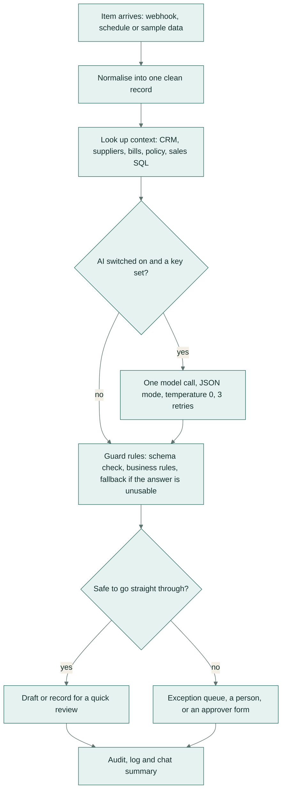

1. **An item arrives** through a webhook, the schedule, or the **Try with sample data** trigger, which loads
   labelled items from the mock services so tests run the same nodes as real traffic.
2. **A Code node normalises it** into one clean record, whichever way it came in.
3. **Context is looked up** over HTTP: duplicates in the CRM, the supplier list and existing bills, the spending
   policy and recent purchases, or yesterday's sales through a read-only SQL query.
4. **The AI step** runs only when the `AI switched on?` gate allows it. It is one chat-completions call in JSON
   mode at temperature 0 (the most repeatable setting), retried up to three times. If it fails, the run carries
   on.
5. **Guard rules decide.** A Code node checks the answer against a fixed list of allowed values and fields,
   applies the business rules, and falls back to the rule-based path when the answer is missing or unusable.
6. **The result goes somewhere safe:** a draft, a review queue, an exception queue, or an approver's form.
7. **Everything is recorded** in an audit log, a log of discarded items, or a chat summary. If a production run
   fails, the shared error workflow logs it and alerts `#ops-alerts`.

## Results

Measured with `python -m opsflow eval` on 132 labelled items, every workflow running in n8n 2.8.4. "Rules only" is
the same workflow with the model switched off. Held-out items were never used while tuning. Full tables, every
item not handled correctly, and the method: [results/RESULTS.md](results/RESULTS.md) and
[docs/evaluation.md](docs/evaluation.md).

| Workflow | Items | Rules only | AI + rules | AI, held out | Guard hits | Straight through |
|---|---|---|---|---|---|---|
| Lead intake and enrichment | 24 | 20/24 (83%) | 23/24 (96%) | 7/8 | 3 | 88% |
| Supplier invoice to draft bill | 24 | 9/24 (38%) | 24/24 (100%) | 8/8 | 12 | 50% |
| Customer support triage | 24 | 23/24 (96%) | 24/24 (100%) | 8/8 | 5 | 50% |
| Daily KPI digest | 21 days | 21/21 (100%) | 21/21 (100%) | 7/7 | 2 | 100% |
| Purchase approval routing | 24 | 18/24 (75%) | 24/24 (100%) | 8/8 | 18 | 33% |
| Blog post to social drafts | 15 posts | 7/15 (47%) | 11/15 (73%) | 4/5 | 7 | 80% |

What the numbers show:

- **Invoices** are where AI matters most: generic label patterns read only 10 of 24 invoice totals across the
  three layouts, the model read every field on all 24. No invoice that should have been an exception became a
  bill.
- **Support triage** keyword rules are already strong on these emails; the AI adds the last item (a swollen
  headlamp battery that no keyword covers) and writes the reply drafts. The safety and legal rules sent all 5
  urgent emails to a person.
- **KPI digest:** the model's text was rejected twice for numbers that were not in the data (it wrote $7,755 for
  $7,755.50 rounded up to $7,756), and the template was posted instead, so every posted digest is grounded.
- **Content:** the misses are drafts flagged for an edit (a "5 minutes" not written that way in the post, a
  harmless "best", a missing date). No risky claim reached a draft marked ready.
- **Items not handled correctly:** 5 of 132 with AI + rules: one lead priority (hot instead of warm) and four
  blog posts with a draft needing an edit.

**Model calls:** 132 calls in the AI run, 0 failures, about 57,000 input and 21,000 output tokens; median model
latency 1.8 to 6.1 seconds per workflow; under US$0.0002 per item at the assumed price. Over the build, 132 live
calls were made (88 for the dev split, then 44 for the held-out split); the AI run above answered the dev items
from the cache.

**Time saved** at the stated volumes (assumptions in `data/time_model.csv`, rates measured above):

| Workflow | Manual min/item | Min/item after | Volume/month | Hours saved/month |
|---|---|---|---|---|
| Lead intake and enrichment | 9 | 2.4 | 120 | 13.3 |
| Supplier invoice to draft bill | 7 | 3.0 | 220 | 14.7 |
| Customer support triage | 6 | 3.5 | 600 | 25.0 |
| Daily KPI digest | 30 | 1.0 | 30 | 14.5 |
| Purchase approval routing | 10 | 2.2 | 80 | 10.4 |
| Blog post to social drafts | 45 | 12.1 | 8 | 4.4 |
| **Total** | | | | **82** |

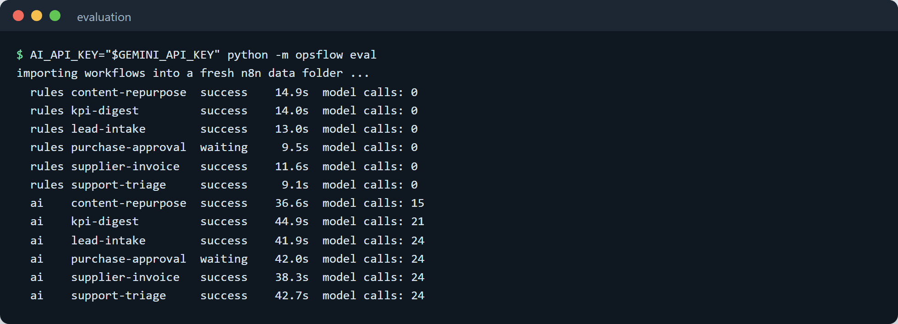
*The evaluation running every workflow twice, once with the model off and once with it on.*

## Tech stack

| Area | Tools |
|---|---|
| Workflow engine | n8n 2.8 (Webhook, Schedule, Manual, Code, HTTP Request, IF, Loop Over Items, Wait with form, Extract from File, Error Trigger) |
| AI | Gemini `gemini-flash-lite-latest` through its OpenAI-compatible API |
| Workflow builder, evaluation, mock services | Python 3.11+ standard library (http.server, sqlite3, urllib) |
| Guard rules | JavaScript inside n8n Code nodes, tested with `node:test` |
| Test data | fpdf2 for the invoice PDFs |
| Quality | pytest, ruff, GitHub Actions |
| Screenshots | Playwright with headless Chrome |
| Self-hosting | Docker Compose: n8n with Postgres, plus the mock services |

## Setup

Needs Python 3.11+, Node 20+ and n8n.

```bash
python -m pip install -e ".[dev]"     # the project and its dev tools
npm install -g n8n                    # or point N8N_BIN at an existing n8n install
```

**Self-hosting with Docker** (n8n on Postgres plus the mock services):

```bash
cp .env.example .env                  # fill in the values
docker compose up -d
docker compose exec n8n n8n import:workflow --separate --input=/workflows
```

### Configuration

Environment variable names only; set the values in your shell or `.env`.

| Variable | Used by | Purpose |
|---|---|---|
| `AI_API_KEY` | n8n | model key, read through `$env`; leave empty for the rule-based path |
| `AI_BASE_URL` | n8n | OpenAI-compatible endpoint (default: the Gemini API) |
| `AI_MODEL` | n8n | model name (default `gemini-flash-lite-latest`) |
| `AI_MODE` | n8n | `off` forces the rule-based path |
| `MOCK_BASE_URL` | n8n | where the mock business systems run |
| `SAMPLE_SPLIT`, `SAMPLE_LIMIT` | n8n | which sample items the sample trigger loads |
| `N8N_BLOCK_ENV_ACCESS_IN_NODE` | n8n | must be `false` so workflows can read `$env` |
| `N8N_BIN` | Python tools | path to the n8n command |
| `AI_UPSTREAM_URL`, `AI_MIN_INTERVAL` | model gateway | provider URL and minimum seconds between live calls |
| `POSTGRES_PASSWORD`, `N8N_ENCRYPTION_KEY`, `WEBHOOK_URL` | Docker Compose | n8n and database settings |

## Usage

```bash
python -m opsflow demo                         # mock services + n8n editor with all workflows imported
python -m opsflow mock                         # only the mock services and ops console on :8790
python -m opsflow build                        # regenerate workflows/*.json from opsflow/flows
python -m opsflow validate                     # check wiring, secrets and guard rules
python -m opsflow eval --gateway replay        # re-run the evaluation from the stored model answers, no key needed
AI_API_KEY=... python -m opsflow eval          # run it live (new prompts go to the model)
python -m opsflow eval --modes rules --gateway off   # rule-based path only, never calls a model
```

Calling a workflow as production traffic would, once it is published in n8n:

```bash
curl -X POST http://localhost:5678/webhook/support-email \
  -H "Content-Type: application/json" \
  -d '{"from": "jo.harding@example.com", "subject": "Stove", "text": "The stove leaked gas."}'
```

## Project structure

```
n8n-ops-automation/
├── opsflow/
│   ├── flows/            one Python file per workflow: nodes, wiring and prompts
│   ├── js/               guard rules and helpers inlined into the Code nodes
│   ├── mock/             mock business systems, model gateway, ops console
│   ├── eval/             runner, scoring and report
│   ├── n8n.py            node helpers that produce n8n JSON
│   ├── build.py          writes workflows/*.json
│   ├── validate.py       static checks used by CI
│   ├── n8n_cli.py        imports and executes workflows through the n8n CLI
│   ├── kpi.py            independent KPI calculation for the expected values
│   ├── demo.py           the one-command demo
│   └── cli.py            python -m opsflow ...
├── workflows/            the generated n8n workflow files (import these)
├── data/
│   ├── samples/          labelled items, dev and held-out
│   ├── seed/             CRM, suppliers, bills, POs, policy, sales orders
│   ├── invoices/         24 invoice PDFs
│   └── time_model.csv    time-saved assumptions
├── eval-cache/ai/        stored model answers for offline replays
├── results/              RESULTS.md, summary.json, items.csv
├── scripts/              make_data.py, screenshots.mjs
├── tests/                pytest suites and tests/js (node:test)
├── docs/                 workflow details, evaluation method, screenshots, demo GIF
├── docker-compose.yml
└── .github/workflows/ci.yml
```

## Tests

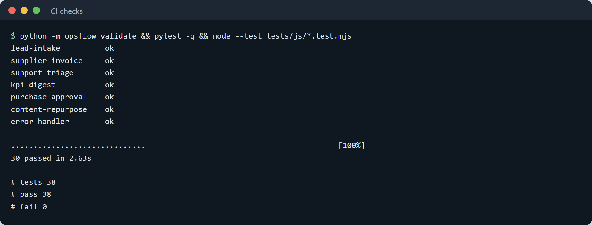
*The same checks CI runs, passing locally.*

- **30 pytest tests:** the builder is deterministic and matches the committed files, the validator catches a
  stored key, a broken connection, a missing guard and an unsafe write; the mock services (CRM matching,
  draft-only bills, read-only SQL, notes, console); the model gateway (cache, key never stored, retries, replay,
  missing key); the labelled data and KPI labels; the scoring and time-saved formula.
- **38 JavaScript tests** for the guard rules inside the Code nodes: spam and injection rules, safety and legal
  wording, invoice checks, KPI number grounding, the spending policy, and the content checks.
- **CI** (`.github/workflows/ci.yml`) runs ruff, `python -m opsflow validate`, pytest and the JavaScript tests,
  then installs n8n and runs every workflow on the rule-based path. It never calls a model.

Run locally:

```bash
ruff check . && ruff format --check . && python -m opsflow validate && python -m pytest -q && node --test "tests/js/*.test.mjs"
```

## Licence

MIT. Copyright (c) 2026 Samiul Huda. See [LICENSE](LICENSE).
